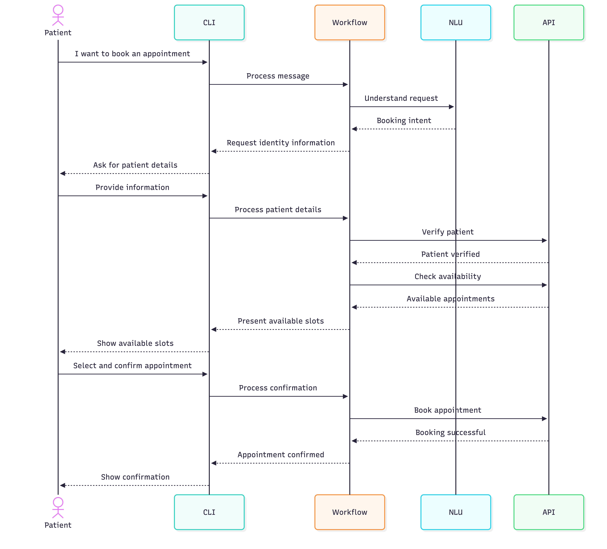

# AI Appointment Scheduling Assistant (prototype)

A text-based, multi-turn assistant that helps a patient find a provider, look up an
existing appointment, or book a new one against the provided mock scheduling API.

`I completed this within the assigned 3-hour window.`

* Python 3.8+, **standard library only** (no `pip install`). The OpenAI API is called over
  plain HTTPS; the key is read from the environment and is never written to disk or logs.
* Works with **or without** an OpenAI key: an LLM parser is used when `OPENAI_API_KEY` is
  set, and a deterministic rule-based parser otherwise (also the fallback if the LLM call
  fails). Both feed the same validated contract into the same workflow code.
* 13 scripted eval scenarios + 17 unit tests. The evals pass 13/13 with the rule parser
  (offline, a few seconds) and 13/13 with the OpenAI parser (`gpt-4o-mini`, about 2 s per turn).

---

## 1. Setup

```bash
git clone <this repo>
cd patient_appointment_project
python3 --version        # 3.8 or newer
cp .env.example .env     # then paste the temporary OpenAI key into .env (optional)
source .env              # or: export OPENAI_API_KEY="sk-..."
```

`.env` is git-ignored. Nothing else to install.

## 2. Start the provided mock scheduling API

```bash
python3 mock-api/server.py          # -> mock scheduling API on http://localhost:4010
```

Leave it running in its own terminal. State is in memory; restart it to reset bookings.

## 3. Run the assistant

```bash
python3 -m assistant.cli            # uses the OpenAI NLU if OPENAI_API_KEY is set
python3 -m assistant.cli --no-llm   # force the deterministic rule-based NLU
python3 -m assistant.cli --verbose  # also echo JSON trace events to stderr
```

Options: `--api-base URL` (default `http://localhost:4010`), `--trace-file PATH`
(default `traces/session-<timestamp>.jsonl`, `-` to disable), `--mock-scenario api_failure`
(send the mock's outage header on every request).

In-session slash commands: `/reset`, `/scenario api_failure`, `/scenario off`, `/state`, `/quit`.

### Example conversations

Provider lookup (no identity needed):

```
you> Which primary care providers are available downtown?
assistant> Here are the primary care providers at downtown I found:
             - Dr. Elena Brooks (primary care) - locations: downtown, uptown; visit types: in person, virtual
             - Dr. Marcus King (primary care) - locations: downtown; visit types: in person
```

Booking happy path:

```
you> I want to book a primary care appointment at the downtown clinic
assistant> To book that, I first need to verify who you are. Please share the phone number on your file and your date of birth ...
you> 555-0101 and 1985-04-12
assistant> Thanks, Maya - I found your record.
           Here's what's available:
             1. Tue Dec 1, 2026 at 9:00 AM - Dr. Elena Brooks at downtown
             2. Tue Dec 1, 2026 at 11:00 AM - Dr. Marcus King at downtown
             3. Wed Dec 2, 2026 at 8:30 AM - Dr. Marcus King at downtown
           Which one would you like? Reply with the number.
you> 1
assistant> You picked: Tue Dec 1, 2026 at 9:00 AM - primary care with Dr. Elena Brooks at downtown.
           Shall I book this appointment? Please reply 'yes' to confirm or 'no' to choose a different time.
you> yes
assistant> You're booked! primary care with Dr. Elena Brooks at downtown on Tue Dec 1, 2026 at 9:00 AM.
           Confirmation number: appt_9002 (status: scheduled).
```

Failure / handoff triggers (all from `mock-api/README.md`): phone `555-9999` + DOB
`1990-01-01` (no match), `555-0130` + `1978-09-22` (two matches, asks for zip),
"I have chest pain, should I wait?" (medical advice), picking the 8:30 AM downtown slot
(`slot_conflict_001`, always 409), dermatology at lakeside (nothing available),
`/scenario api_failure` (503 on every call), "talk to a human", "book a cardiology appointment".

## 4. Tests and evals (run these)

```bash
python3 -m unittest discover -s tests -v      # 17 offline unit tests, < 1 s
python3 -m evals.run_evals                    # 13 scenario evals; starts a fresh mock per scenario
python3 -m evals.run_evals -v -k slot_conflict  # print the conversation for one scenario
python3 -m evals.run_evals --llm              # same scripts through the OpenAI parser (needs key)
```

Evals assert on three things per turn: what the user saw (including that no patient data
leaks on failure paths), exactly which API calls were made with what status (e.g. exactly one
`POST /appointments` with `confirmed: true`, and none before the user said yes), and the
workflow state / handoff reason recorded in the trace. `scenarios.yaml` ids map 1:1 to
scenario ids in `evals/run_evals.py`, plus a few extra (decline-then-rebook, unresolved zip,
human request, unsupported specialty, existing-appointment lookup).

---

## 5. Architecture


Sequence of a typical booking conversation:



### Who decides what

| Decision | Owner | Why |
| --- | --- | --- |
| What the user *means* (intent), which entities are present, which numbered slot "the 11am one" refers to | **Model** (or rules) | Fuzzy language; the only place an LLM adds value here |
| Whether identity is required, when a confirmation counts, which API to call next, how to react to each status code, when to hand off and with which `reason` | **Code** (`workflow.py`) | Policy must be enforced deterministically and be testable offline |
| Who the patient is, what slots exist, whether a booking succeeded, the handoff id | **API** | The source of truth; nothing shown to the user originates anywhere else |
| Every user-facing sentence | **Code templates filled from API data** | Removes the fabrication risk entirely; the model never writes prose |

### Repository layout

```
assistant/       api_client.py  nlu.py  workflow.py  tracing.py  cli.py
evals/           run_evals.py  (scenario harness, starts its own mock)
tests/           test_units.py (offline unit tests)
mock-api/ openapi/ data/ policies.md scenarios.yaml assignment.md   (provided package)
.env.example     environment variables; .env is git-ignored
```

## Key Design Decisions

### 1. Use the LLM to understand requests, not to make decisions

I use the LLM to understand what the patient wants and extract useful information from their messages. It receives the current conversation state and returns structured JSON, which is validated by the application.

The LLM does not directly call APIs, book appointments, or make business decisions. All these actions are controlled by Python code. This makes the application more predictable, easier to test, and safer.

During testing, I noticed that the LLM sometimes misunderstood short answers like "1" or "primary care." To address this, the workflow prioritizes what it previously asked the patient rather than relying entirely on the intent returned by the LLM.

Similarly, when a patient says "yes" to a booking confirmation, the application books the appointment that was explicitly presented to them, rather than relying on the LLM to select a slot.

### 2. Protect sensitive patient information

Phone numbers and dates of birth are extracted locally and masked before sending messages to the LLM whenever the local parser recognizes them. The application also validates any information extracted by the LLM before using it.

This reduces unnecessary exposure of sensitive patient information. However, the current masking approach may not recognize every natural-language date format.

### 3. Enforce important business rules in code

I implemented three important safety rules directly in the application rather than relying on the LLM.

- **Identity verification:** The patient must be identified before accessing patient-specific information or booking an appointment. If multiple records match, the assistant asks for a ZIP code. If the identity cannot be resolved, the conversation is handed off to staff.
- **Booking confirmation:** The assistant must receive explicit confirmation before booking an appointment. Even if the patient requests and confirms an appointment in the same message, the assistant asks for a separate confirmation to avoid accidental bookings. The API client also checks that confirmation has been provided.
- **Medical advice:** The assistant is designed for appointment scheduling, not medical consultation. Both the LLM and a keyword-based check help identify medical questions. These requests are handed off to staff, with standard emergency guidance rather than medical advice.

These rules provide an additional layer of protection even when the LLM returns an unexpected result.

### 4. Handle failures gracefully

The application should never tell a patient that an action was successful when it was not.

If the scheduling API is temporarily unavailable or a connection fails, the application retries once. If the retry fails, it attempts to hand off the conversation to staff.

If the handoff also fails, the assistant explains the situation and recommends contacting the front desk directly.

If an appointment becomes unavailable during booking, the application retrieves the latest availability and presents alternative options instead of continuing with outdated information. The conflicting slot is excluded for the remainder of the session.

### 5. Keep logging simple and useful

I added structured logging to make the application easier to debug and evaluate. Each log records useful information such as the session, conversation turn, processing time, and outcome.

Sensitive information is masked, and identifiers are replaced with fingerprints where appropriate. The evaluation scripts also use these logs to verify that the application behaves as expected.

## Assumptions

To keep the assessment focused and avoid unnecessary complexity, I made the following assumptions:

- **Phone numbers:** The mock API uses seven-digit phone numbers. Longer phone numbers are normalized to their last seven digits to match the sample data.
- **Patient verification:** Once a patient is verified, they remain verified throughout the current session. Raw identity lookup information is discarded after the lookup.
- **Personalized responses:** The assistant uses the patient's first name after successful verification. It does not reveal patient names when the identity is unclear.
- **No available appointments:** If no appointments are available and the patient requests staff assistance, the assistant creates a handoff with the appropriate reason.
- **Appointment search:** The assistant asks for a specialty and preferred location. Patients can also select any location.
- **Unavailable slots:** If an appointment fails because it is no longer available, that slot is not offered again during the same session.
- **Time zones:** Appointment times are displayed as provided by the mock API, without additional timezone conversion.

These assumptions are specific to the assessment and could be revisited for a production application.

## Known Limitations

The current implementation focuses on the core scheduling requirements rather than building a complete production-ready system.

- **Rule-based fallback:** The fallback parser uses simple keywords and patterns, so it may not understand every possible way a patient expresses a request.
- **Limited LLM evaluation:** The LLM has been evaluated against 13 scripted scenarios. More testing is needed for different wording, unexpected inputs, and prompt injection attempts.
- **Limited search options:** Patients cannot yet search by a specific date range or preferred provider.
- **Session management:** The application supports a single in-memory session. It does not include persistent conversation history, authentication, or multi-user support.
- **Privacy protection:** The current masking approach reduces sensitive information exposure but does not guarantee that all sensitive information is removed.
- **Conversation experience:** Responses use predefined templates. This keeps them accurate and predictable, but they may feel less natural than fully generated responses.

I intentionally kept these areas simple to stay within the scope of the assessment.

## What I Would Do Next

These are the steps I would take to turn this prototype into a real product, in the order I would do them. The main design stays the same: the LLM only understands the message, the code enforces the rules, and the API is the source of truth.

1. **Connect to the real scheduling system.** Replace the mock API with the clinic's real scheduling system behind the same `SchedulingClient` interface, and add service authentication and rate-limit handling. I expect two things to break first:
   - **Booking retries:** The client retries a failed request once, including `POST /appointments`. If the first request succeeds but the response is lost, the retry returns 409 and the patient is told that nothing was booked, although an appointment exists. I would send an idempotency key with every booking, and when the result is unknown, check the patient's appointments before telling them anything.
   - **Time zones:** Times are shown exactly as the API returns them. I would show every time in the clinic's time zone and name the time zone in the message.
2. **Verify identity properly.** A phone number and a date of birth are easy for another person to know. I would send a one-time code to the phone number on file (or use the patient portal login), limit the number of attempts, and expire a verified session after a short period without activity.
3. **Run it as a service for many patients.** Move from the CLI to an HTTP service behind a web chat or SMS channel. The `Session` dataclass already holds all conversation state, so I would store it in Redis or a database with an expiry time. Then many patients can talk at the same time, and a conversation survives a restart.
4. **Meet healthcare privacy requirements.** Before using real patient data, I would need a signed agreement with the LLM provider that covers patient data (a BAA under HIPAA) with no data retention, encryption in transit and at rest, secrets in a secrets manager, and an audit log of every access to a patient record. I would also improve the masking to cover more date formats, names, and addresses.
5. **Build a larger eval set and run it on every change.** Grow from 13 scenarios to a few hundred: different wording, typos, several requests in one message, prompt injection, and many forms of medical questions. Every change to the prompt, model, or workflow must pass before release, and a policy failure (booking without confirmation, a data leak, a missed medical handoff) blocks the release. After launch, I would add failed real conversations to the set, with patient data removed.
6. **Add monitoring and alerts.** Send the existing structured traces to a central system and build a dashboard for booking success rate, handoff rate by reason, API error rate, LLM fallback rate, response time per step, and cost per conversation. Alert when any of these changes suddenly.
7. **Control response time and cost.** Today every turn calls the LLM (about 2 seconds), even for answers like "1" or "yes" that the rule parser already understands. I would skip the LLM for those turns. In the booking example above, that is three of the four turns. I would also lower the LLM timeout from 20 seconds to a few seconds before falling back to the rules.
8. **Roll out gradually, with a quick way back.** Start with internal staff, then one clinic and a small share of patients, and expand only while the metrics stay healthy. Add switches to turn off the LLM parser (the rule-only mode already exists), to turn off booking, or to send every conversation to staff. Keep the prompt and model name in versioned configuration, so a rollback is a configuration change and not a code change.
9. **Add new features after the foundation is stable.**
    - **Reschedule and cancel:** Use the same identity check and explicit confirmation as booking. For a reschedule, book the new slot first and cancel the old one only after that succeeds, so the patient never loses both. If the cancel step fails, hand off to staff with both appointment numbers.
    - **Better search:** Support date ranges, a preferred provider, and requests such as "find me the earliest available appointment."
    - **More natural replies:** Let the LLM improve the wording, but keep every time, name, and confirmation number filled in by code from API data.
