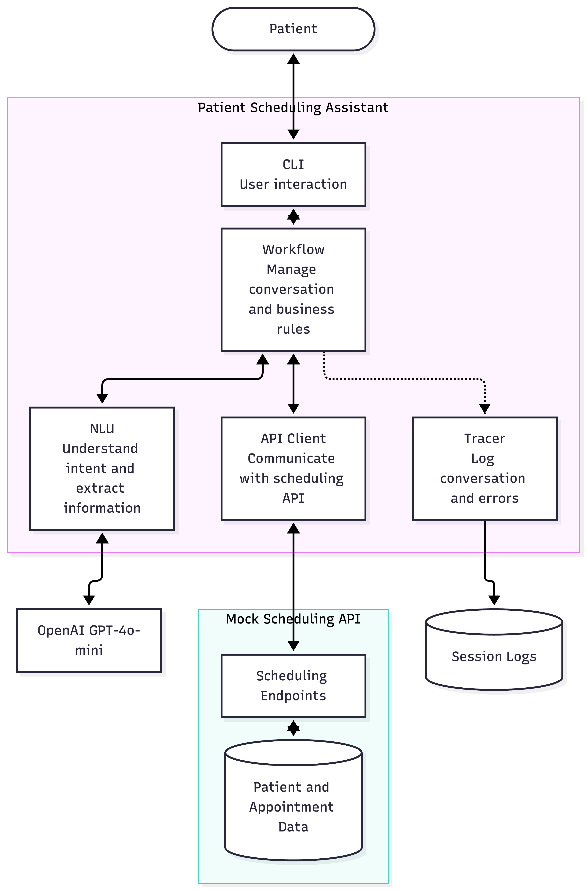

# AI Appointment Scheduling Assistant (prototype)

A text-based, multi-turn assistant that helps a patient find a provider, look up an
existing appointment, or book a new one against the provided mock scheduling API.

`I completed this within the assigned 3-hour window.`

* Python 3.8+, **standard library only** (no `pip install`). The OpenAI API is called over
  plain HTTPS; the key is read from the environment and is never written to disk or logs.
* Works with **or without** an OpenAI key: an LLM parser is used when `OPENAI_API_KEY` is
  set, and a deterministic rule-based parser otherwise (also the fallback if the LLM call
  fails). Both feed the same validated contract into the same workflow code.
* 13 scripted eval scenarios + 17 unit tests. The evals pass 13/13 with the rule parser
  (offline, a few seconds) and 13/13 with the OpenAI parser (`gpt-4o-mini`, about 2 s per turn).

---

## 1. Setup

```bash
git clone <this repo>
cd patient_appointment_project
python3 --version        # 3.8 or newer
cp .env.example .env     # then paste the temporary OpenAI key into .env (optional)
source .env              # or: export OPENAI_API_KEY="sk-..."
```

`.env` is git-ignored. Nothing else to install.

## 2. Start the provided mock scheduling API

```bash
python3 mock-api/server.py          # -> mock scheduling API on http://localhost:4010
```

Leave it running in its own terminal. State is in memory; restart it to reset bookings.

## 3. Run the assistant

```bash
python3 -m assistant.cli            # uses the OpenAI NLU if OPENAI_API_KEY is set
python3 -m assistant.cli --no-llm   # force the deterministic rule-based NLU
python3 -m assistant.cli --verbose  # also echo JSON trace events to stderr
```

Options: `--api-base URL` (default `http://localhost:4010`), `--trace-file PATH`
(default `traces/session-<timestamp>.jsonl`, `-` to disable), `--mock-scenario api_failure`
(send the mock's outage header on every request).

In-session slash commands: `/reset`, `/scenario api_failure`, `/scenario off`, `/state`, `/quit`.

### Example conversations

Provider lookup (no identity needed):

```
you> Which primary care providers are available downtown?
assistant> Here are the primary care providers at downtown I found:
             - Dr. Elena Brooks (primary care) - locations: downtown, uptown; visit types: in person, virtual
             - Dr. Marcus King (primary care) - locations: downtown; visit types: in person
```

Booking happy path:

```
you> I want to book a primary care appointment at the downtown clinic
assistant> To book that, I first need to verify who you are. Please share the phone number on your file and your date of birth ...
you> 555-0101 and 1985-04-12
assistant> Thanks, Maya - I found your record.
           Here's what's available:
             1. Tue Dec 1, 2026 at 9:00 AM - Dr. Elena Brooks at downtown
             2. Tue Dec 1, 2026 at 11:00 AM - Dr. Marcus King at downtown
             3. Wed Dec 2, 2026 at 8:30 AM - Dr. Marcus King at downtown
           Which one would you like? Reply with the number.
you> 1
assistant> You picked: Tue Dec 1, 2026 at 9:00 AM - primary care with Dr. Elena Brooks at downtown.
           Shall I book this appointment? Please reply 'yes' to confirm or 'no' to choose a different time.
you> yes
assistant> You're booked! primary care with Dr. Elena Brooks at downtown on Tue Dec 1, 2026 at 9:00 AM.
           Confirmation number: appt_9002 (status: scheduled).
```

Failure / handoff triggers (all from `mock-api/README.md`): phone `555-9999` + DOB
`1990-01-01` (no match), `555-0130` + `1978-09-22` (two matches, asks for zip),
"I have chest pain, should I wait?" (medical advice), picking the 8:30 AM downtown slot
(`slot_conflict_001`, always 409), dermatology at lakeside (nothing available),
`/scenario api_failure` (503 on every call), "talk to a human", "book a cardiology appointment".

## 4. Tests and evals (run these)

```bash
python3 -m unittest discover -s tests -v      # 17 offline unit tests, < 1 s
python3 -m evals.run_evals                    # 13 scenario evals; starts a fresh mock per scenario
python3 -m evals.run_evals -v -k slot_conflict  # print the conversation for one scenario
python3 -m evals.run_evals --llm              # same scripts through the OpenAI parser (needs key)
```

Evals assert on three things per turn: what the user saw (including that no patient data
leaks on failure paths), exactly which API calls were made with what status (e.g. exactly one
`POST /appointments` with `confirmed: true`, and none before the user said yes), and the
workflow state / handoff reason recorded in the trace. `scenarios.yaml` ids map 1:1 to
scenario ids in `evals/run_evals.py`, plus a few extra (decline-then-rebook, unresolved zip,
human request, unsupported specialty, existing-appointment lookup).

---

## 5. Architecture



Sequence of a typical booking conversation:


### Who decides what

| Decision | Owner | Why |
| --- | --- | --- |
| What the user *means* (intent), which entities are present, which numbered slot "the 11am one" refers to | **Model** (or rules) | Fuzzy language; the only place an LLM adds value here |
| Whether identity is required, when a confirmation counts, which API to call next, how to react to each status code, when to hand off and with which `reason` | **Code** (`workflow.py`) | Policy must be enforced deterministically and be testable offline |
| Who the patient is, what slots exist, whether a booking succeeded, the handoff id | **API** | The source of truth; nothing shown to the user originates anywhere else |
| Every user-facing sentence | **Code templates filled from API data** | Removes the fabrication risk entirely; the model never writes prose |

### Repository layout

```
assistant/       api_client.py  nlu.py  workflow.py  tracing.py  cli.py
evals/           run_evals.py  (scenario harness, starts its own mock)
tests/           test_units.py (offline unit tests)
mock-api/ openapi/ data/ policies.md scenarios.yaml assignment.md   (provided package)
.env.example     environment variables; .env is git-ignored
```